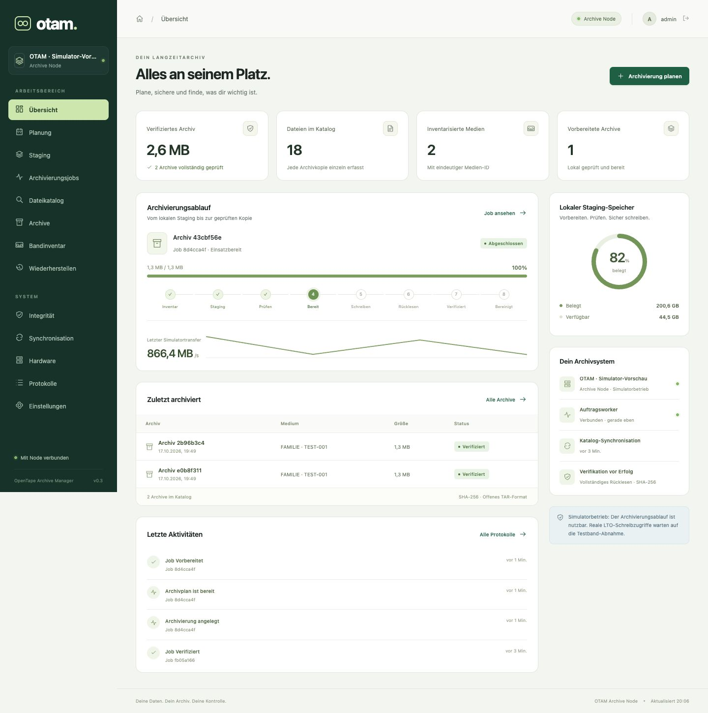

# OpenTape Archive Manager (OTAM)

Offener, sicherheitsorientierter Archivierungskern für private Linux-Bandarchive. **Version 0.8.0 mit kombinierter lokaler Validierung, gepufferter physischer Rücklesung, aktuellem Archivplan auf der Übersicht und ausdrücklich wählbarem Batchmodus für unbegonnene Medien.** Dazu kommen deutsche/englische Weboberfläche, lokale Benutzerverwaltung, separater Worker und eigenständiger Katalogdienst. Ein persistenter Bandsimulator ermöglicht Tests ohne Hardware. Physische Initialisierung, Archivierung und Mehrbandbetrieb besitzen getrennte, standardmäßig deaktivierte administrative Gates. Der aktuelle Abnahmestand und die Grenzen einer Freigabe stehen in [production-readiness.md](docs/production-readiness.md).

[Projektübersicht und Funktionsstand](docs/project-overview.md) · [Weboberfläche und Installation](docs/web.md) · [Modulare Architektur](docs/architecture/modular-web.md)

Implementiert: lesende Linux-Erkennung, SQLite-Katalog, SHA-256-Inventar und bestätigte Archivplanung, persistentes lokales Staging mit Wiederaufnahme, PAX-TAR mit selbstbeschreibendem Manifest, Append mit Medien-ID und Prozesssperre, vollständige Rücklesung vor VERIFIED, sichere selektive Wiederherstellung, Suche/Exporte, Neustartbehandlung und Katalogrekonstruktion. Keine automatische Quelllöschung oder Medienwiederverwendung. MIT-Lizenz.

```bash
python3 -m otam --help
python3 -m otam doctor
python3 -m unittest discover -v
```

Python >=3.11. Der CLI-Kern benötigt nur die Standardbibliothek; die optionale Web-Laufzeit nutzt FastAPI, Uvicorn und HTTPX mit festgehaltenen Versionen. Einstieg in den vollständigen Testzyklus: [Bedienungsanleitung](docs/usage.md).

- [Architektur](docs/architecture/overview.md), [Alternativen](docs/architecture/alternatives.md), [Risiken](docs/architecture/risks.md), [Entwicklungsplan](docs/architecture/plan.md)
- [Hardware-Abnahme und lokale Diagnoseberichte](docs/hardware/README.md)
- [Installation](docs/installation.md), [Konfiguration](docs/configuration.md), [Datenbankschema](docs/database.md), [Bandformat](docs/tape-format.md), [verbindliches Staging](docs/staging.md)
- [Disaster Recovery ohne Datenbank](docs/disaster-recovery.md), [Wiederherstellung ohne OTAM](docs/recovery-without-otam.md)
- [Entwicklung](docs/development.md), [Test- und Abnahmeplan](docs/testing.md)

Die vorhandenen Server-Skripte wurden über SSH ausschließlich gelesen und bleiben unverändert. Alle Archive werden vor dem Bandstream vollständig auf einem qualifizierten lokalen Dateisystem vorbereitet. Filemark-/EOD-/EOM-Verhalten und der reguläre Archiv-/Restore-Pfad des IBM ULT3580-HH4 wurden auf ausdrücklich freigegebenen Testmedien geprüft; andere Laufwerksprofile benötigen eigene Hardwareabnahme. Softwaretests ersetzen diese Hardwareabnahme nicht. V1 archiviert reguläre Dateien; ACLs/xattrs/Links/leere Verzeichnisse und vollständige Systemstände sind noch nicht enthalten.

Staging-TARs werden erst nach vollständiger Rückleseverifikation entfernt. `stage`, `staging-status` und `staging-benchmark` ergänzen die CLI; ein bestandener Simulatorjob ist weder Hardware- noch 120-MB/s-Leistungsfreigabe.

## Web und eigenständiger Katalog

Quellen größer als ein LTO-4-Band können als Folge vollständiger TAR-Archive auf mehrere Medien verteilt werden. Vor jedem weiteren Medium ist eine neue Bestätigung nötig. Optional liest OTAM erst nach allen TARs eines Mediums zurück; dafür müssen alle TARs dieses Mediums bis zur Verifikation lokal im Staging bleiben. Bei kleinerem Staging den archivweisen Modus wählen. Der physische Wechselpfad wurde mit zwei kleinen, explizit zugeordneten Kindaufträgen geprüft; Kapazitätsverteilung ist zusätzlich softwaregetestet. Siehe die dokumentierten Abnahmegrenzen.

Planung, Staging, bestätigte Archivierung, Dateisuche, selektiver Restore, Medienübersicht, Integritätsprüfungen und Protokolle sind über eine responsive deutsche Oberfläche bedienbar. Lange Aufgaben laufen dauerhaft protokolliert in einem separaten Worker. Jeder Archive Node besitzt zwingend seinen lokalen Katalog. Zusätzliche Catalog Nodes mit eigener Suchoberfläche und Snapshot-Verzeichnisse sind optional und unter **Synchronisation** frei konfigurierbar, auch mehrfach. Signierte, versionierte Snapshots synchronisieren diese Ziele unabhängig voneinander. Ein Catalog Node bleibt bei ausgeschaltetem Bandserver durchsuchbar; er kann auf einem beliebigen geeigneten Linux-Rechner, einer VM oder einem Container laufen. Proxmox und NAS sind lediglich mögliche Einsatzbeispiele. Keine SQLite-Datei gemeinsam über NFS öffnen.

```bash
python -m pip install -r packaging/requirements-web.lock
python -m pip install --no-deps --no-build-isolation .
otam web-init --config /srv/otam/node.json --root /srv/otam/archive-node --source /mnt/readonly-source
otam serve --config /srv/otam/node.json
# Separater Prozess:
otam worker --config /srv/otam/node.json
```

Standardzugriff: http://127.0.0.1:8765. Eigenes Passwort bei Initialisierung; kein Standardpasswort. [Konfigurationsreferenz](docs/web-configuration.md), [Modularer Betrieb und Einsatzbeispiele](docs/web.md) und Vorlagen für systemd/Container im Verzeichnis `packaging/`.



Quellen und lokale Staging-Verzeichnisse sind in der Weboberfläche registrierbar und bei der Planung auswählbar. Die Hardwareansicht erkennt Laufwerke automatisch und bietet separat bestätigten physischen Wartungsbetrieb für Vollqualifikation, begrenzte Dauertests sowie Kurz-/Langlöschen. Reguläre physische Archivierung erfordert das separate administrative Gate und bestätigte Medien-/Transferbindungen. [Wartungsabläufe und Freigaben](docs/architecture/physical-maintenance.md).
