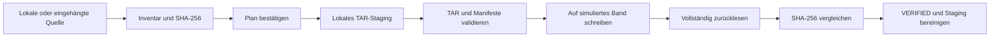

# Was OTAM derzeit kann

Stand: Version 0.3.0. OTAM umfasst einen Python-Archivierungskern mit CLI und persistentem Bandsimulator, eine responsive Weboberfläche, eine REST-API, einen separaten Worker und einen eigenständigen Katalogdienst. Eine produktive physische LTO-Abnahme steht aus.

## Implementiert und automatisiert geprüft

| Bestandteil | Aktueller Umfang |
|---|---|
| Quelleninventar | Reguläre Dateien, relative Pfade, Größe, mtime, SHA-256; Ablehnung spezieller Dateitypen |
| Archivplanung | Zielgröße standardmäßig 75 GB, größere Einzeldateien separat, konservative Kapazitätsreserve, ausdrückliche Planbestätigung |
| Lokales Staging | Vollständige PAX-TARs, Manifeste und Hashes; lokale persistente Dateisysteme prüfen; Platzprüfung; READY erst nach Validierung |
| Archivierungsablauf | Persistente Phasen, Medien-ID-Abgleich, Prozesssperren, sequenzielles Append im Simulator |
| Verifikation | Vollständiges Rücklesen des simulierten Mediums, TAR- und Datei-Prüfsummen; VERIFIED erst nach Erfolg; kein zweites großes Rücklese-TAR nötig |
| Katalog | SQLite, versioniertes Schema/Migration, Medien, Archive, Dateien, Jobs, Ereignisse und Wiederherstellungen |
| Suche und Export | Textsuche in Dateinamen/Pfaden, SHA-256-Suche und Kopien, JSON-/CSV-Export |
| Wiederherstellung | Ausgewählte Dateien, Pfade oder alle Dateien eines Mediums; vorheriger Restore-Plan; SHA-256-Prüfung; kein Überschreiben vorhandener Dateien |
| Ausfallsicherheit | Schreib-/Lesefehler, Bandende, Prozessabbruch, Neustart, geänderte Staging-Dateien, falsches Medium und Locks im Simulator getestet |
| Disaster Recovery | Katalogrekonstruktion aus Medieninhalt, selbstbeschreibende Manifeste, unabhängiges Recovery-Skript und GNU-tar-Anleitung |
| Hardwarediagnose | Lesende Linux-Erkennung und langer Direct-I/O-Staging-Benchmark; physische Bandintegration bleibt gesperrt |

## Datenweg



SQLite protokolliert den Ablauf dauerhaft. Quelldateien bleiben erhalten. Ein Fehler führt nicht zu einer Erfolgsmeldung oder automatischer Wiederverwendung des Mediums.

## Noch ausstehend

- Realer LTO-Schreib-/Leseadapter mit mt-st und mbuffer; sichere Positionierung, Filemarks, EOD/EOM und physischer Testband-Zyklus.
- Geführte Mehrbandplanung und Medienwechsel, umfassende Suchfilter und Medienverwaltung.
- Tatsächliche Installation und Betriebsabnahme auf Bandserver und Proxmox-/NAS-Zielumgebung. Webdashboard, REST-API, Worker und Servicevorlagen sind implementiert.
- TapeAlert/Gesundheitsansichten, Rotation mit Aufbewahrungsregeln, vollständige System-Snapshots und Verschlüsselung.
- ACLs, xattrs, Links, leere Verzeichnisse und vollständige Linux-Systemmetadaten gehören noch nicht zum Dateiarchivierungsumfang.

## Aufbau und Bedienung

Python >=3.11 und Standardbibliothek, SQLite und offenes PAX-TAR, MIT-Lizenz. Keine Telemetrie, Cloudpflicht oder externen Laufzeitdienste. Installation und spätere Nutzung können ohne Internet erfolgen, wenn Python und benötigte Systemwerkzeuge vorhanden sind.

```bash
python3 -m otam --help
python3 -m otam doctor
python3 -m unittest discover -v
```

Der [vollständige Simulatorzyklus](usage.md) zeigt Planung, Staging, Archivierung, Suche und Restore. Weitere Details: [Architektur](architecture/overview.md), [Entwicklungsplan](architecture/plan.md), [Disaster Recovery](disaster-recovery.md).

## Modulare Weboberfläche

[Bedienung und Installation](web.md), [Konfiguration und API](web-configuration.md), [Datenhoheit und Replikation](architecture/modular-web.md). Planung, Staging, bestätigte Archivierung, Dateikatalog, Restore, Integrität und Synchronisation sind integriert. Der eigenständige Katalog besitzt keine Hardware-Schreibfähigkeiten und veröffentlicht nur validierte Snapshots seines festgelegten Herausgebers.
