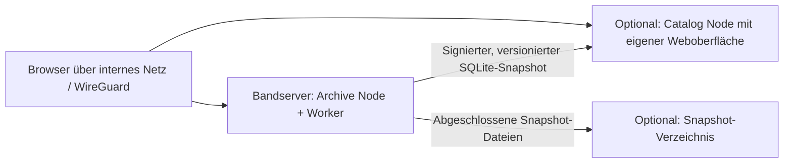

# Weboberfläche und modularer Betrieb

OTAM 0.5 umfasst eine authentifizierte responsive Weboberfläche mit deutscher und englischer Sprache, lokale Benutzerverwaltung, REST-API, separate persistente Auftragsausführung und einen unabhängig betreibbaren Katalogdienst. Der echte LTO-Adapter bleibt bis zur ausdrücklich freigegebenen Testband-Abnahme für reguläre Archivierung deaktiviert. Verfügbare Archivierungsaktionen verwenden den persistenten Simulator.

## Ansichten und Bedienablauf

- **Übersicht:** verifizierte Archivbytes, Dateikopien, Medien, vorbereitete Archive, letzter Jobablauf, gemessener Simulator-Datendurchsatz, freier Staging-Speicher, Aktivitäten.
- **Planung:** innerhalb einer freigegebenen Quelle einzelne Dateien oder rekursive Unterordner im Dateibrowser auswählen; ohne Auswahl die ganze Quelle. Ein oder mehrere Simulatormedien in der angezeigten Reihenfolge sowie TAR-Zielgröße und Verifikationsmodus wählen. Quellen über 800 GB werden auf vollständige TARs und mehrere Medien verteilt, sofern die konservativ geschätzte Kapazität reicht. Einzelne Dateien werden nicht geteilt. Der Jobdialog zeigt Quelle, Medienfolge, Umfang und unveränderlichen Plan-Hash.
- **Staging:** vollständige lokale TARs vorbereiten; Fortschritt und persistente Phasen anzeigen. Alle Archive können separat vorab vorbereitet werden, alternativ erfolgt die Vorbereitung archivweise während des Archivjobs. Kein direktes NAS-zu-Band-Streaming.
- **Archivierungsjobs:** dauerhaft gespeicherte Queue getrennt von Archiv-/Prüfjobs. Mehrbandplan vor jedem Medium mit vollständiger Job-ID bestätigen. Nach der Verifikation eines Mediums hält OTAM mit `WAITING_MEDIA` an und zeigt das nächste Medium. Optional werden alle TARs eines Mediums zuerst geschrieben und erst danach vollständig zurückgelesen. In diesem Modus müssen alle TARs des Mediums bis zur Verifikation lokal vorliegen; bei wenig Stagingplatz die archivweise Rücklesung wählen. Bei expliziter Wiederaufnahme wird die Mediensequenz erneut geprüft; partielle Archive werden nicht blind fortgeschrieben.
- **Dateikatalog:** paginierte Suche nach Pfad/Name, Dateityp, Größe, Änderungsdatum, SHA-256, Medium, Archiv und Zustand. Exakte Dubletten/Kopien anzeigen. Alle Kopien einer Prüfsumme finden; JSON-/CSV-Export. CSV neutralisiert Formeln in Dateinamen für Tabellenprogramme.
- **Archive und Bandinventar:** Archivposition, Medienzuordnung, Dateianzahl, Status und logische Kapazität; neue Simulatormedien erstellen, vollständig prüfen, Katalog rekonstruieren oder unterbrochene Jobs erfassen. Keine automatische Wiederverwendung rotierender Medien.
- **Wiederherstellung:** Dateien im Katalog markieren, nach Medium/Archiv gruppieren, Plan mit Medien-ID, Banddateien, Datenmenge und Ziel prüfen. Jede Gruppe wird in ein neues Zielverzeichnis unter dem festgelegten Restore-Root wiederhergestellt und verifiziert. Auf dem Catalog Node ist die Auswahl als JSON-Medienliste exportierbar; diese Liste ist noch kein automatisch importierbarer oder an den Bandserver versendeter Auftrag.
- **Integrität:** vollständige Medienprüfung starten, Archiv-Prüfergebnisse und Fehler lesen. Hardware-Schnellprüfung und einzelne physische LTO-Archivprüfungen sind noch nicht integriert.
- **Synchronisation:** Lokaler Pflichtkatalog und beliebig viele optionale Katalogdienste oder Snapshot-Verzeichnisse. Ziele hinzufügen, bearbeiten, aktivieren/deaktivieren und entfernen; eigener Schlüssel, Intervall und Einzelstatus. Manuelle Veröffentlichung oder Workerintervall. Identische bestätigte Snapshots werden pro unverändertem Ziel nicht erneut übertragen.
- **Hardware, Einstellungen, Protokolle:** lesende Erkennung, aktive Module und freigegebene Quellen sowie strukturierte Ereignisse. Quellen und lokale Basispfade bleiben in der geschützten Node-Konfiguration; optionale Veröffentlichungsziele werden in der authentifizierten Weboberfläche verwaltet.

Bei mehr als einem Medium werden Restoregruppen derzeit einzeln bestätigt; ein geführter physischer Medienwechsel ist noch nicht implementiert. Mehrbandplanung und geführter Schreibwechsel gelten bislang nur für den Simulator. Kapazität wird konservativ geschätzt; bei unerwartetem Bandende gibt es kein automatisches Überlaufen oder Aufteilen eines TARs. Im Simulator getestete Vorgänge sind keine Hardwareabnahme. Verfügbare Menüs und serverseitige Routen richten sich nach der Node-Rolle.

## Lokal starten

```bash
python3 -m venv .venv
.venv/bin/python -m pip install -r packaging/requirements-web.lock
.venv/bin/python -m pip install --no-deps --no-build-isolation .

# Neu anlegen, sichere Passwortabfrage, keine vorhandene Konfiguration überschreiben.
.venv/bin/otam web-init --config /srv/otam/node.json \
  --root /srv/otam/archive-node --role archive --source /mnt/readonly-source
.venv/bin/otam serve --config /srv/otam/node.json
# Zweites Terminal:
.venv/bin/otam worker --config /srv/otam/node.json
```

Browser: http://127.0.0.1:8765. Benutzername standardmäßig `admin`; Passwort ist das bei Initialisierung gewählte. Kein ausgeliefertes Standardpasswort. Alternativ `--password-file` mit einer nur für den Betreiber lesbaren Datei, Modus 0600. Weder Passwort noch Schlüssel in die Shellargumente schreiben.

## Sprache, Benutzer und Rollen

Unter **Einstellungen → Sprache** kann jeder angemeldete Benutzer zwischen Deutsch und Englisch wechseln. Die Auswahl wird pro Konto gespeichert; Datums- und Zahlenformate folgen der Sprache. Vor der Anmeldung merkt sich der Browser die zuletzt verwendete Sprache. Dateinamen, Archivpfade und IDs bleiben unverändert. Beide Oberflächen funktionieren ohne Internetverbindung oder externe Übersetzungsdienste.

Administratoren verwalten unter **Einstellungen → Benutzerverwaltung** lokale Konten: Benutzer anlegen, Rolle ändern, Konten deaktivieren/reaktivieren und Passwörter zurücksetzen. Jeder Benutzer kann sein eigenes Passwort nach Eingabe des bisherigen Passworts ändern. Passwörter benötigen mindestens 12 Zeichen und werden mit PBKDF2-SHA256 (600.000 Iterationen, zufälliges Salt) gespeichert. Eine Rollenänderung, Deaktivierung oder Passwortzurücksetzung beendet alle Sitzungen des betroffenen Kontos. Der letzte aktive Administrator kann nicht deaktiviert oder herabgestuft werden.

| Rolle | Rechte |
| --- | --- |
| Administrator | Benutzer, Einstellungen, Synchronisationsziele, Quellen/Staging und freigabepflichtige Bandwartung verwalten; Jobs bedienen |
| Operator | Archivierungs- und Wiederherstellungsjobs bedienen und Katalog durchsuchen; keine Benutzer-, Sicherheits- oder Bandwartungsfreigaben verwalten |
| Leser | Katalog, Hardwarestatus, Jobs und Protokolle lesen; eigene Sprache und eigenes Passwort ändern |

Konten sind **pro Node lokal**. Katalog-Snapshots übertragen keine Benutzer, Passwort-Hashes oder Sitzungen. Für einen eigenständigen Catalog Node werden dessen Konten gesondert verwaltet. Eine Datenbankspalte `mfa_state` ist für spätere Zwei-Faktor-Authentifizierung reserviert; 2FA ist in 0.5 **nicht verfügbar**. Ein unbekannter/aktivierter MFA-Zustand führt derzeit zur Ablehnung der Anmeldung, damit eine spätere Migration nicht stillschweigend 2FA umgeht.

Beim Upgrade von der alten Steuerdatenbank-Version 1 auf Version 2 bleiben Einstellungen, Auftragsdaten und Synchronisationsverlauf erhalten. Das bisherige Konfigurations-Administratorkonto wird einmalig importiert. Alte Sitzungen werden bewusst ungültig; nach dem Upgrade bitte erneut anmelden. Vor einem produktiven Upgrade beide Dienste stoppen und eine konsistente Sicherung von `control.sqlite` samt WAL sowie der Node-Konfiguration erstellen. Nach dem Upgrade das frühere Administratorkennwort weiterverwenden; spätere Kennwortänderungen bleiben bei Neustarts erhalten.

Die Dienste müssen als derselbe dedizierte Benutzer laufen und identische Konfiguration/TMPDIR verwenden. Der Worker besitzt einen exklusiven Node-Lock und die Kern-I/O-/Medienlocks. Ohne Worker bleiben neue Aufträge sichtbar QUEUED. Ein Browserneuladen setzt keinen Job zurück. Nach einem harten Workerabbruch werden laufende Queue-Aufträge INTERRUPTED; Kernjobs über den Medien-Werkzeugdialog bewusst prüfen. Kein automatisches Retry von Band-Schreibjobs.

Nach Metadatenänderung eines READY-TARs kann der Jobdialog vor einem Bandversuch eine **ausdrückliche erneute Staging-Prüfung** anbieten. Diese bestätigt denselben ursprünglichen TAR-Hash und das vollständige Dateimanifest; Inhalt und Dateiidentität dürfen nicht abweichen. CLI: `stage JOB_UUID --staging /lokaler/pfad --revalidate-ready`. Kein Umgehen einer fehlgeschlagenen Prüfsumme.

## Optionaler eigenständiger Katalogdienst (Beispiel Proxmox)

Empfohlene Zielanordnung:



Proxmox ist nur ein Deploymentbeispiel, keine OTAM-Voraussetzung; ein anderer Linux-Host, eine VM oder ein geeigneter Container funktionieren mit denselben Rollen. Im unprivilegierten Debian-LXC-Container eigenes persistentes lokales Volume für `/var/lib/otam` verwenden. Die Datenbank des Catalog Node wird nicht direkt auf das NAS gelegt. Ein dediziertes Dienstkonto `otam`, Python >=3.11 und die Webinstallation wie oben genügen; kein Bandgerät und kein Archivierungsworker im Katalogcontainer erforderlich.

Initialisierung auf dem jeweiligen System:

```bash
otam web-init --config /etc/otam/node.json --root /var/lib/otam --role catalog
```

Die Konfiguration unter `/etc/otam` muss vom Dienstkonto lesbar sein und gegen andere Benutzer geschützt werden. Schreibbare Laufzeitdaten unter `/var/lib/otam` müssen dem Dienstkonto gehören. `/var/lib/otam/tmp` mit Modus 0700 anlegen. Servicevorlagen: `packaging/systemd/otam-web.service` und auf dem Bandserver zusätzlich `otam-worker.service`. Vor Aktivierung Dienstpfad `/opt/otam/venv`, Quellenrechte und tatsächliche Datenpfade an die Installation anpassen. Für andere Staging-/Restore-/NAS-Ziele die zulässigen Schreibpfade über einen systemd-Drop-in ergänzen. Kein root-Betrieb erforderlich. Die Vorlagen gewähren noch keinen physischen Bandzugriff.

Optional kann der Archive Node Administratoren einen bestätigungspflichtigen Shutdown unter **Einstellungen** anbieten. Dazu `allow_host_shutdown=true` setzen und die gesonderten Units `otam-poweroff.path`/`.service` aus `packaging/systemd` für den tatsächlichen State- und TMPDIR-Pfad installieren. Nur dieser eng begrenzte systemd-Helfer läuft als root; Web und Worker bleiben unprivilegiert. Während eines OTAM-Auftrags oder einer gehaltenen I/O-Sperre wird kein Shutdown angenommen. Die Einrichtung und Grenzen stehen in der [Konfigurationsreferenz](web-configuration.md).

Optionaler OCI-Container: `packaging/container/Dockerfile` und `compose.yaml`. Im Compose-Verzeichnis eine eigene `node.json` aus dem kommentierten Beispiel erzeugen; keine Platzhalter als echte Konfiguration verwenden. `state=/data/state`, Rolle catalog, Node-ID und Passwort-Hash aus `web-init`, eigener persistenter Daten-Volume. Der Prozess läuft als UID/GID 10001; Konfigurations-/Schlüsseldateien entsprechend lesbar (0600, Eigentümer UID 10001), Volume schreibbar. Externe Bindung ausschließlich auf ausdrücklich gewählte interne/WireGuard-Adresse. Die Vorlage bindet den Hostport standardmäßig an 127.0.0.1. Ohne laufende Container-Engine ist ein erfolgreicher Imagebau nicht nachgewiesen; native Paket- und HTTP-Tests sind davon unabhängig.

## Peer verbinden

1. Auf dem Archive Node dessen `node_id` aus Konfiguration/Einstellungen ablesen.
2. Einen eigenen zufälligen Peer-Schlüssel erzeugen, z. B. `python3 -c 'import secrets; print(secrets.token_urlsafe(48))'`, direkt in eine geschützte Datei schreiben. Die Datei auf beiden Nodes sicher bereitstellen, nicht per Chat oder Git.
3. Catalog Node: `publisher_id` auf die Archive-Node-ID und `peer_key_file` auf die lokale Schlüsseldatei setzen.
4. Archive Node: Unter **Synchronisation → Ziel hinzufügen** Typ **Katalogdienst** wählen, Basisadresse und denselben geheimen Schlüssel eintragen. HTTPS verwenden; internes HTTP nur bewusst freigeben. Keine Zugangsdaten oder API-Pfade in die URL schreiben. Weitere Instanzen lassen sich unabhängig hinzufügen.
5. `host`, `port` und `allowed_hosts` ausdrücklich für die tatsächlichen internen Adressen konfigurieren; beide Dienste kontrolliert neu starten. Bei HTTP über WireGuard `allow_http_peer=true` ausdrücklich setzen. Kein öffentlicher HTTP-Zugang und keine deaktivierte TLS-Prüfung.
6. Über Synchronisation → Jetzt synchronisieren veröffentlichen. Auf der Katalogoberfläche Sequenz, Zeitpunkt und Dateien prüfen. Danach Bandserver-Web/Worker stoppen und die Suche im Catalog Node erneut abnehmen.

Der Schlüssel autorisiert ausschließlich die feste Replikationsschnittstelle, keinen Archivierungsauftrag oder SQL-Zugang. Empfänger akzeptieren keine fremden Herausgeber, abweichende gleiche Sequenzen oder Rückschritte. Bei Restore eines alten Primärsystems kann dessen persistente Sequenz hinter dem Empfänger liegen; dann wird die Übertragung verweigert. Nicht den Empfängerstand still löschen: Dienste stoppen, Katalog und Steuerdaten sichern, maßgeblichen Stand prüfen und Herausgeber/Sequenz bewusst wiederherstellen. V1 hat dafür keine automatische Konfliktauflösung.

Ein SSH-Tunnel ist eine weitere Transportoption für getrennte Standorte: Der Catalog Node darf auf `127.0.0.1:8765` lauschen, während ein eigener, dauerhaft überwachter SSH-Client auf dem Archive Node einen lokalen Port dorthin weiterleitet. Das Katalogziel verwendet dann `http://127.0.0.1:<lokaler-port>` mit `allow_http: true` ausschließlich innerhalb des authentifizierten Tunnels. Den SSH-Hostschlüssel unabhängig prüfen und fest hinterlegen; den Veröffentlichungsschlüssel getrennt vom SSH-Schlüssel erzeugen. Der permanente Transportschlüssel soll nur Portweiterleitung zum Katalogport erlauben, ohne Shell oder freie Zielwahl. Ein Administrationsschlüssel gehört in ein separates Konto mit möglichst eng begrenzten Rechten. Der Tunnel ist optional: OTAM selbst verlangt weder Proxmox noch SSH.

## Optionales Snapshot-Verzeichnis (Beispiel NAS)

Nur abgeschlossene Snapshot-Dateien, niemals eine live gemeinsam geöffnete SQLite-Datei. Unter **Synchronisation → Ziel hinzufügen** Typ **Snapshot-Verzeichnis** wählen und absoluten Pfad des bereits gemounteten Ziels sowie einen eigenen Signaturschlüssel hinterlegen. Anschließend über **Zielmarker** die Node-ID bestätigen, nachdem der gewünschte Mount geprüft wurde. Alternativ den Marker `.otam-backup-target` bewusst mit der Archive-Node-ID als Inhalt administrativ anlegen. Schlüssel für spätere unabhängige Signaturprüfung sicher aufbewahren. Ein fehlender/fremder Marker blockiert den Export und hilft, ein ungemountetes lokales Ersatzverzeichnis zu erkennen. Die Anwendung mountet/erzeugt dieses Ziel nicht selbst.

SQLite-Datei und signiertes JSON-Manifest besitzen eindeutige Namen aus Herausgeber und Sequenz. Vorhandene Dateien werden nicht überschrieben. Eine `.partial`-Datei oder ein Snapshot ohne passendes Manifest ist kein abgeschlossener Backup-Satz. Den Worker-Dienst erst nach dem NAS-Mount starten, etwa mit einem installationsspezifischen `RequiresMountsFor=`-Drop-in. Verfügbarkeit und Stromversorgung des NAS bleiben betriebliche Voraussetzungen.

## Standalone, Alter und Grenzen

Der Catalog Node zeigt den letzten **erzeugten Katalogstand** mit Alter/Sequenz. Er fragt bei der Suche den Bandserver nicht ab. Er kann keine noch nicht synchronisierten Änderungen kennen. Aus unverändertem Katalogalter allein folgt kein Erreichbarkeitsnachweis. Unveränderte Kataloge werden nicht wiederholt als neue Dateien archiviert; bekannte alte Snapshot-Dateien werden nicht automatisch gelöscht. Platz und eine spätere ausdrücklich konfigurierte Aufbewahrung überwachen.

Snapshots kopieren derzeit den vollständigen Katalog, nicht die Quelldateien/TARs. Das Snapshotlimit beträgt standardmäßig 1 GiB; für größere Kataloge bewusst anpassen und Replikations-/Suchleistung messen. Die Kerninventarisierung/Planung hält weiterhin Manifeste im RAM und ist für Millionen Dateien noch nicht profiliert. Die Webschicht hebt diese Grenze nicht auf. Unterstützung mehrerer unabhängiger Bandserver, bidirektionale Katalogänderungen, HA und automatische Primärwahl sind nicht enthalten.

## Sicherheit und Tests

Standard: 127.0.0.1, feste Host-Allowlist, geschützte Sessions, feste Sitzungsdauer, CSRF-/Origin-Prüfung, Anmeldebegrenzung, keine CORS-Freigabe. Beim internen TLS-Reverse-Proxy `secure_cookie=true` und ausschließlich dessen IPs in `trusted_proxy_ips` konfigurieren; Forwarded-Header sind standardmäßig unvertrauenswürdig. Proxy darf nur die benötigten internen/WireGuard-Netze zulassen. `PrivateDevices=true` verhindert bei den Servicevorlagen Geräteschreibzugriffe zusätzlich.

```bash
python -m unittest discover -v
python -m unittest tests.test_web -v
```

HTTP-Tests prüfen Authentifizierung, Rollen, Queue, Planbestätigung, Staging/Archiv/Restore, Filter/Exporte, Replikation bei ausgefallenem Primärkatalog, unvollständige/korrupten Snapshots, Replay, idempotente Veröffentlichung und NAS-Export. Browserprüfung und tatsächliche Proxmox-/NAS-/iOS-Abnahme getrennt dokumentieren. Details: [Architektur](architecture/modular-web.md), [Konfiguration](web-configuration.md).

## Quellen-/Stagingauswahl und Bandwartung

Unter **Einstellungen** lassen sich bestehende Quell- und Staging-Verzeichnisse aus administrativ freigegebenen Bereichen registrieren. **Planung** bietet Quelle, Staging und Zielmedium an; ein ausgewähltes Unterverzeichnis kann als eigene Quelle hinzugefügt werden. **Staging** zeigt alle registrierten lokalen Ziele und deren freien Speicher. Registrierung/Abmeldung verändern keine Quelldateien. Noch gebundene Jobs und unverifizierte Dateien verhindern die Abmeldung.

Unter **Hardware** werden angeschlossene Laufwerke automatisch erkannt und Simulator bzw. physischer Wartungsbetrieb gewählt. Der Moduswechsel allein verändert kein Band. Vollqualifikation und Kurz-/Langlöschen brauchen jeweils eine frische Einzelfreigabe mit Laufwerks- und Medienseriennummer. Die Vollqualifikation schreibt rekonstruierbare Daten bis zur regulären Early-Warning-Grenze und liest alles vollständig zurück. Nur vollständige Integritätsgleichheit gilt als VERIFIED. Löschen wird als abgeschlossenes Kommando, nicht als zertifizierte Vernichtung gemeldet.

Reguläre physische Archivierung bleibt bis zur Bandformat-Abnahme gesperrt. Kein Laufwerk, unbekannte Identität, Schreibschutz, alte oder bereits verbrauchte Freigabe führen zu keiner destruktiven Ausführung. [Details und Abnahmegrenzen](architecture/physical-maintenance.md).

## Laufwerk und Medium auf der Übersicht

Die Übersicht zeigt unter **Laufwerk & eingelegtes Medium** Modell, Seriennummer, Firmware, zuletzt erkanntes Medium, Schreibschutz und Abfragezeitpunkte. Fehlender Kontakt und alte Messwerte sind ausdrücklich gekennzeichnet. Unter **Hardware → Diagnosedaten** stehen verfügbare Temperatur-/Fehlerzähler, dauerhaft gespeicherte TapeAlert-Hinweise und ausklappbare Rohdaten. **Status & Diagnose aktualisieren** stellt einen lesenden Auftrag in die Workerwarteschlange. Details: [Diagnosearchitektur und Datenbedeutung](architecture/drive-diagnostics.md).
